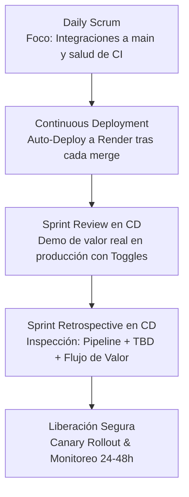

# 📘 Scrum + Trunk-Based Development (TBD) Playbook
> **Versión:** 3.0.0 (Actualizada en Taller 6)  
> **Ámbito:** Equipo de Ingeniería, Producto & DevOps  
> **Institución:** UNIPUTUMAYO - Tecnología en Desarrollo de Software  
> **Autor Líder:** Franklin Sneider Córdoba De La Cruz  
> **Docente Facilitador:** Juan Pablo  
> **Estado:** Oficial / Operación en Producción  

---

## 🧭 1. Principios Fundamentales (Las 5 Reglas de Oro en CD)

1. **Trunk como Única Fuente de Verdad (`main` Siempre Releasable):**  
   Todo commit en `main` debe pasar la suite de pruebas automatizadas y estar listo para desplegarse a producción de forma autónoma.
2. **Ramas de Vida Ultra-Corta (< 24 Horas):**  
   Las ramas de trabajo deben fusionarse en menos de un día. Si una funcionalidad toma más tiempo, se debe practicar *vertical slicing* y ocultar tras un *Feature Toggle*.
3. **Desacoplamiento Estricto: Despliegue (Deploy) ≠ Liberación (Release):**  
   Desplegar a producción es un evento técnico diario y automatizado. Liberar valor al usuario final es una decisión de negocio controlada dinámicamente mediante *Feature Flags* (ej. ConfigCat).
4. **Code Reviews Prioritarias e Inmediatas (< 2 Horas):**  
   Revisar código ajeno es más prioritario que iniciar nuevo trabajo. Lotes pequeños (≤ 200 líneas) facilitan auditorías rápidas.
5. **Responsabilidad Colectiva y Cuarentena de Tests Flaky:**  
   Un pipeline roto en `main` detiene cualquier nueva integración. Los tests intermitentes (flaky) se aíslan de inmediato en cuarentena para no bloquear el tronco común.

---

## 👥 2. Matriz de Roles en Continuous Deployment

| Rol | Responsabilidad en CD + TBD | Compromisos Diarios |
| :--- | :--- | :--- |
| **Product Owner (PO)** | Gestiona el valor y el riesgo de negocio. Define estrategias de encendido porcentual de Feature Toggles y participa en la validación continua. | *"Monitorearé la adopción real en producción y encenderé toggles basándome en telemetría de negocio, no en fechas impuestas sin métricas."* |
| **Developers (Devs)** | Mantienen `main` verde. Integran diariamente en micro-lotes. Diseñan la arquitectura de fallback de los toggles y eliminan la deuda técnica asociada. | *"No mantendré ramas vivas por más de 24 horas y removeré del código todo toggle que supere los 30 días de antigüedad."* |
| **Scrum Master (SM)** | Facilita la observabilidad del flujo de valor y métricas DORA. Protege al equipo de la presión comercial prematura y coordina las ceremonias adaptadas. | *"Facilitaré retrospectivas enfocadas en la salud del pipeline y Lead Time, asegurando que las acciones de mejora se cumplan."* |

---

## 🔄 3. Adaptación Oficial de Ceremonias Scrum en Continuous Deployment

### 3.1 El Nuevo Sprint Review en CD
* **Objetivo:** Demostración de valor tangible y funcional en producción (Render), contrastando hipótesis de negocio y estado de activación sin comprometer fechas prematuras.
* **Duración Máxima:** 45 minutos.
* **Diferencia Fundamental con el Review Clásico:**
  * **Review Clásico:** Demostración de un incremento "todo o nada" en un entorno local o de staging aislado, con feedback diferido al final del sprint.
  * **Review en CD + TBD:** Demostración de lo que ya reside en producción real, desacoplado mediante Feature Flags (ConfigCat), evaluando telemetría y métricas de negocio.

#### Protocolo Oficial de la Demo en Vivo:
1. **Demo con Toggle en OFF primero (Estado Real Actual):** Se proyecta la aplicación en Render mostrando la pasarela estándar (*"Completar formulario y Pagar"*), demostrando que la rama `main` en producción no genera alteración ni riesgo alguno a los usuarios reales.
2. **Activación Temporal Restringida:** Se conmuta el toggle temporalmente **solo para el equipo (o un usuario de prueba)** y se muestra el nuevo flujo de *"Pagos Express en 1 Clic"*.
3. **Comunicación Transparente del PO (Speech Oficial):**
   > *“La funcionalidad está técnicamente lista y desplegada, pero todavía no la hemos liberado a usuarios reales porque necesitamos definir métricas de observación y resolver riesgos de estabilidad del pipeline. La campaña de marketing se pausará o se ajustará.”*
4. **Gestión de Expectativas:** Se **evita comprometer una fecha de activación al 20% en el Review**, supeditando cualquier liberación a la satisfacción de los acuerdos técnicos y de telemetría.

---

### 3.2 La Nueva Sprint Retrospective en CD
* **Objetivo:** Inspeccionar la estabilidad del flujo de entrega continua, la salud del pipeline y la disciplina en Trunk-Based Development.
* **Ejes Obligatorios de Inspección:**
  1. **Salud del Pipeline:** Frecuencia de rotura de CI, duración promedio de build, fallos de healthcheck y necesidad de rollbacks.
  2. **Disciplina TBD:** Tasa de integraciones diarias a `main`, duración máxima de vida de las ramas (< 24h), y erradicación de tests flaky.
  3. **Flujo de Valor:** Lead Time for Changes (tiempo desde el primer commit hasta producción) y verificación de si el valor llegó realmente a los usuarios finales.

#### Dinámica del Tablero (Miro):
* 🟢 **Verde (Lo que funcionó bien):** Automatización eficiente, auto-deploys estables a Render, desacople entre deploy y release vía ConfigCat.
* 🟡 **Amarillo (Fricciones):** Tests flaky en CI que demoraron integraciones, presión comercial del PO por activar en viernes sin observabilidad, solo 4 integraciones en el sprint.
* 🔴 **Rojo (Lo que rompió el flujo o causó miedo):** Caída de 11 minutos por healthcheck fallido, rollback manual no automatizado, acumulación de 3 toggles obsoletos (+45 días).

#### Las 3 Acciones Concretas de Mejora (Asignadas):
1. **Acción 1: Arreglar el test flaky en las próximas 24 h (Máxima Prioridad).**  
   *Responsable:* Developers. Aislar, refactorizar o mockear de inmediato el test intermitente que bloqueó el CI por 4 días.
2. **Acción 2: Crear un dashboard mínimo de métricas de pagos (errores + conversión) antes de cualquier activación.**  
   *Responsable:* Devs + PO. Implementar telemetría en tiempo real sobre errores HTTP 5xx/pasarela y tasa de conversión antes de liberar tráfico externo.
3. **Acción 3: Limpiar o eliminar los 3 toggles antiguos en este mismo sprint.**  
   *Responsable:* Equipo / PO. Erradicar del código base los 3 feature toggles con más de 45 días de vida para pagar la deuda técnica acumulada.

#### Acuerdo de Equipo Vinculante:
> 🤝 **Acuerdo de Equipo:**  
> **No se activará ningún toggle nuevo a usuarios reales hasta que el health check no haya fallado en los últimos 7 deploys.**

---

## 🎛️ 4. Política Oficial de Liberación Segura (Decisión Final)

### 4.1 Evaluación: ¿Activar al 20% el Viernes?
* **Decisión Final:** **NO SE ACTIVA EL 20% ESTE VIERNES.**
* **Justificación Técnica:** Incumple ventanas seguras (no liberar antes del fin de semana sin guardia técnica activa); antecedente reciente de fallo de 11 minutos en health check; persisten tests flaky en CI; y falta telemetría básica de pagos.

### 4.2 Plan Acordado de Liberación Progresiva (5 Pasos)
1. **Paso 1:** Resolver test flaky + limpiar toggles viejos (esta semana).
2. **Paso 2:** Implementar métricas básicas de error y conversión (máximo 3 días).
3. **Paso 3:** Activar primero solo para usuarios internos / equipo (1-2 días de observación).
4. **Paso 4:** Si todo está estable → subir al 5% → 20% con observación de 48 h en cada paso.
5. **Paso 5:** Criterio de rollback automático: **cualquier aumento > 0,5% en errores de pago** desactiva inmediatamente el toggle en ConfigCat.

### 4.3 Resumen de la Decisión Madura
> 💡 **Resumen:**  
> **Se protege la confianza del pipeline y la disciplina TBD por encima de la presión comercial de corto plazo. Se comunica con transparencia al stakeholder y se define un camino claro y seguro de liberación.**

---

## 🛡️ 5. Protocolo de Erradicación de Tests Flaky y Protección del Trunk

1. **Tolerancia Cero a la Intermitencia:** Un test que falla aleatoriamente por dependencias temporales, concurrencia o llamadas externas no mockeadas es un defecto crítico.
2. **Cuarentena Inmediata (< 2 Horas):** Al identificarse un test flaky en CI, se traslada de inmediato al archivo de cuarentena (`tests/quarantine/`) para evitar que el equipo mantenga ramas vivas por días.
3. **SLA de Reparación:** El test debe ser reescrito con aislamiento determinista en un plazo máximo de 48 horas o ser eliminado definitivamente.

---

## 📋 6. Definition of Done (DoD) Integral v3.0

### DoD Técnico:
- [x] Código integrado en la rama `main` en menos de 24 horas de desarrollo.
- [x] 100% de pruebas unitarias y de integración pasando en verde en CI sin flakiness.
- [x] Linter Ruff ejecutado sin errores ni advertencias de estilo.
- [x] Contenedor Docker compilado y desplegado automáticamente a Render.
- [x] Healthcheck proactivo respondiendo en < 20 ms con liveness y readiness verificados.
- [x] Funcionalidad nueva protegida tras Feature Toggle si no está lista para todos los usuarios.

### DoD de Negocio y Liberación:
- [x] Telemetría y métricas de negocio activas para el nuevo flujo antes de encender el toggle.
- [x] Estrategia de Canary Rollout definida y consensuada con el Product Owner.
- [x] Kill-Switch probado en ConfigCat con capacidad de apagado en < 60 segundos.
- [x] Tarea de limpieza y remoción del toggle agendada en el backlog con fecha de caducidad.

---

## ✅ 7. Auditoría y Cierre de Checklist Fase 1 (100% Completado)

| Ítem de Fase 1 | Criterio de Éxito | Estado | Evidencia |
| :--- | :--- | :---: | :--- |
| **Repositorio TBD** | Rama `main` como única rama persistente | **CERRADO** | Repositorio unificado con ramas efímeras |
| **Pipeline CI Automatizado** | Ejecución de linter, tests y build en cada push/PR | **CERRADO** | GitHub Actions `.github/workflows/ci-cd.yml` |
| **Auto-Deploy Continuo** | Despliegue sin fricción manual a Render | **CERRADO** | Webhook / Container Deployment automatizado |
| **Feature Flags Operativos** | ConfigCat SDK + fallback local resiliente | **CERRADO** | Módulo `app/toggles.py` con targeting y canary |
| **Observabilidad Mínima** | Endpoint de salud y telemetría de negocio | **CERRADO** | `/health` proactivo y `/api/v1/metrics` activos |
| **Playbook Institucional** | Guía de ceremonias, roles y liberación segura v3.0 | **CERRADO** | Playbook oficial adoptado por el equipo |

---

## 💬 8. Reflexión Final del Equipo
> *"En una frase: A partir de este taller, el Sprint Review deja de ser una entrega de código para convertirse en una validación científica de valor en producción, y la Retrospectiva pasa de discutir sentimientos a optimizar matemáticamente la salud del pipeline y el flujo continuo."*
