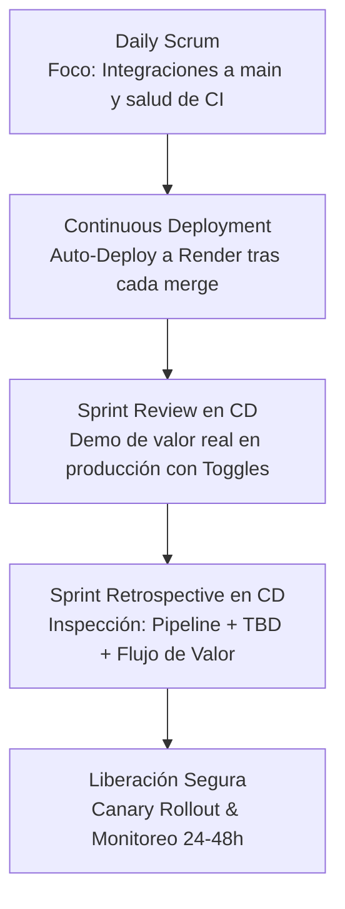
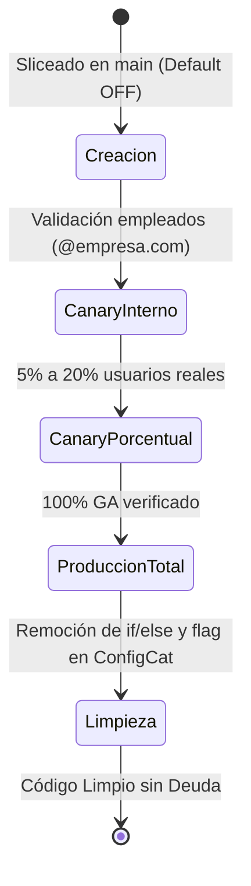

# 📘 Scrum + Trunk-Based Development (TBD) Playbook
> **Versión:** 3.0.0 (Actualizada en Taller 6)  
> **Ámbito:** Equipo de Ingeniería, Producto & DevOps  
> **Institución:** UNIPUTUMAYO - Tecnología en Desarrollo de Software  
> **Autor Líder:** Franklin Sneider Córdoba De La Cruz  
> **Docente Facilitador:** Juan Pablo  
> **Estado:** Oficial / Operación en Producción  

---

## 🧭 1. Principios Fundamentales (Las 5 Reglas de Oro en CD)

1. **Trunk como Única Fuente de Verdad (`main` Siempre Releasable):**  
   Todo commit en `main` debe pasar la suite de pruebas automatizadas y estar listo para desplegarse a producción de forma autónoma.
2. **Ramas de Vida Ultra-Corta (< 24 Horas):**  
   Las ramas de trabajo deben fusionarse en menos de un día. Si una funcionalidad toma más tiempo, se debe practicar *vertical slicing* y ocultar tras un *Feature Toggle*.
3. **Desacoplamiento Estricto: Despliegue (Deploy) ≠ Liberación (Release):**  
   Desplegar a producción es un evento técnico diario y automatizado. Liberar valor al usuario final es una decisión de negocio controlada dinámicamente mediante *Feature Flags* (ej. ConfigCat).
4. **Code Reviews Prioritarias e Inmediatas (< 2 Horas):**  
   Revisar código ajeno es más prioritario que iniciar nuevo trabajo. Lotes pequeños (≤ 200 líneas) facilitan auditorías rápidas.
5. **Responsabilidad Colectiva y Cuarentena de Tests Flaky:**  
   Un pipeline roto en `main` detiene cualquier nueva integración. Los tests intermitentes (flaky) se aíslan de inmediato en cuarentena para no bloquear el tronco común.

---

## 👥 2. Matriz de Roles en Continuous Deployment

| Rol | Responsabilidad en CD + TBD | Compromisos Diarios |
| :--- | :--- | :--- |
| **Product Owner (PO)** | Gestiona el valor y el riesgo de negocio. Define estrategias de encendido porcentual de Feature Toggles y participa en la validación continua. | *"Monitorearé la adopción real en producción y encenderé toggles basándome en telemetría de negocio, no en fechas impuestas sin métricas."* |
| **Developers (Devs)** | Mantienen `main` verde. Integran diariamente en micro-lotes. Diseñan la arquitectura de fallback de los toggles y eliminan la deuda técnica asociada. | *"No mantendré ramas vivas por más de 24 horas y removeré del código todo toggle que supere los 30 días de antigüedad."* |
| **Scrum Master (SM)** | Facilita la observabilidad del flujo de valor y métricas DORA. Protege al equipo de la presión comercial prematura y coordina las ceremonias adaptadas. | *"Facilitaré retrospectivas enfocadas en la salud del pipeline y Lead Time, asegurando que las acciones de mejora se cumplan."* |

---

## 🔄 3. Adaptación Oficial de Ceremonias Scrum en Continuous Deployment

### 3.1 El Nuevo Sprint Review en CD
* **Objetivo:** Demostración de valor tangible y funcional en producción (Render), contrastando hipótesis de negocio y estado de activación.
* **Duración Máxima:** 45 minutos.
* **Diferencia Fundamental con el Review Clásico:**
  * **Review Clásico:** Demostración de un incremento "todo o nada" en un entorno local o de staging aislado, con feedback diferido al final del sprint.
  * **Review en CD + TBD:** Demostración de lo que ya está en producción, protegido o liberado mediante Feature Flags, evaluando telemetría real y métricas de adopción.

#### Estructura Obligatoria de la Demo (Máximo 5 min por ítem):
1. **¿Qué problema de usuario resuelve?** (Contexto del Pain Point).
2. **¿Estado de activación?** (100% público, detrás de Toggle, o en Canary interno).
3. **Demo en Vivo en Producción:** Ejecución del flujo con Toggle OFF vs. Toggle ON y prueba de fallback.
4. **Métrica o Evidencia de Valor:** Observabilidad en tiempo real (ej. tasa de error < 0.5%, latencia, tasa de conversión).
5. **Pregunta Clave al PO / Stakeholder:** *“¿Esto genera el valor esperado por los usuarios según las métricas observadas?”*

---

### 3.2 La Nueva Sprint Retrospective en CD
* **Objetivo:** Inspeccionar la estabilidad del flujo de entrega continua, la salud del pipeline y la disciplina en Trunk-Based Development.
* **Ejes Obligatorios de Inspección:**
  1. **Salud del Pipeline:** Frecuencia de rotura de CI, duración promedio de build, fallos de healthcheck y necesidad de rollbacks.
  2. **Disciplina TBD:** Tasa de integraciones diarias a `main`, duración máxima de vida de las ramas (< 24h), y erradicación de tests flaky.
  3. **Flujo de Valor:** Lead Time for Changes (tiempo desde el primer commit hasta producción) y verificación de si el valor llegó realmente a los usuarios finales.

#### Dinámica del Tablero (Miro):
* 🟢 **Verde (Lo que funcionó bien):** Automatización eficiente, auto-deploys estables, visibilidad de logs.
* 🟡 **Amarillo (Fricciones):** Demoras en code reviews, confusión entre deploy y release, falta de alertas automáticas.
* 🔴 **Rojo (Lo que rompió el flujo o causó miedo):** Tests flaky bloqueando CI, healthchecks colgados por 11 minutos, presión de marketing para activar código sin métricas.
* 🚀 **Acciones de Mejora (Regla: Máximo 3 acciones):** Acciones concretas, medibles, con responsable asignado y Definition of Done.

---

## 🎛️ 4. Política Oficial de Liberación Segura y Gobernanza de Feature Toggles

### 4.1 Ciclo de Vida del Feature Toggle (Límite Máximo: 30 Días)

1. **Fase 0 - Creación:** El código se integra a `main` protegido por flag (default en `False`).
2. **Fase 1 - Canary Interno (Alpha):** Se habilita exclusivamente para usuarios corporativos mediante whitelisting de email (`@empresa.com` o ID interno).
3. **Fase 2 - Canary Progresivo (Beta):** Liberación al 5% durante 2 horas. Si los Golden Signals están saludables, escalar al 20% para satisfacer hitos comerciales.
4. **Fase 3 - Disponibilidad General (GA):** Expansión al 50% y finalmente al 100% tras 24 horas de estabilidad.
5. **Fase 4 - Retiro Obligatorio (Cleanup):** Ningún toggle de liberación puede permanecer en el código más de **30 días**. Si supera los 45 días, se considera deuda técnica crítica y se bloquea el sprint planning hasta su erradicación.

### 4.2 Métricas de Observabilidad Previas a la Activación (Golden Signals)
Antes de activar cualquier toggle en producción, el servicio debe exponer y monitorizar:
* **Tasa de Error (Error Rate):** Umbral aceptable < 0.5%.
* **Latencia p95:** Umbral aceptable < 800 ms.
* **Tasa de Conversión de Negocio:** Comparación de éxito entre flujo tradicional y nuevo flujo.

### 4.3 Protocolo de Rollback Inmediato (Kill-Switch)
* Si en los primeros 15 minutos tras encender el toggle el Error Rate supera el **1.5%** o la latencia excede **1.5 segundos**, el PO o el Dev de guardia tiene la potestad de **apagar el toggle a 0% en ConfigCat inmediatamente**.
* **Tiempo Máximo de Mitigación:** Menos de 60 segundos (sin necesidad de redeploy ni rollback de imagen).

---

## 🛡️ 5. Protocolo de Erradicación de Tests Flaky y Protección del Trunk

1. **Tolerancia Cero a la Intermitencia:** Un test que falla aleatoriamente por dependencias temporales, concurrencia o llamadas externas no mockeadas es un defecto crítico.
2. **Cuarentena Inmediata (< 2 Horas):** Al identificarse un test flaky en CI, se traslada de inmediato al archivo de cuarentena (`tests/quarantine/`) para evitar que el equipo mantenga ramas vivas por días.
3. **SLA de Reparación:** El test debe ser reescrito con aislamiento determinista en un plazo máximo de 48 horas o ser eliminado definitivamente.

---

## 📋 6. Definition of Done (DoD) Integral v3.0

### DoD Técnico:
- [x] Código integrado en la rama `main` en menos de 24 horas de desarrollo.
- [x] 100% de pruebas unitarias y de integración pasando en verde en CI sin flakiness.
- [x] Linter Ruff ejecutado sin errores ni advertencias de estilo.
- [x] Contenedor Docker compilado y desplegado automáticamente a Render.
- [x] Healthcheck proactivo respondiendo en < 20 ms con liveness y readiness verificados.
- [x] Funcionalidad nueva protegida tras Feature Toggle si no está lista para todos los usuarios.

### DoD de Negocio y Liberación:
- [x] Telemetría y métricas de negocio activas para el nuevo flujo antes de encender el toggle.
- [x] Estrategia de Canary Rollout definida y consensuada con el Product Owner.
- [x] Kill-Switch probado en ConfigCat con capacidad de apagado en < 60 segundos.
- [x] Tarea de limpieza y remoción del toggle agendada en el backlog con fecha de caducidad.

---

## ✅ 7. Auditoría y Cierre de Checklist Fase 1 (100% Completado)

| Ítem de Fase 1 | Criterio de Éxito | Estado | Evidencia |
| :--- | :--- | :---: | :--- |
| **Repositorio TBD** | Rama `main` como única rama persistente | **CERRADO** | Repositorio unificado con ramas efímeras |
| **Pipeline CI Automatizado** | Ejecución de linter, tests y build en cada push/PR | **CERRADO** | GitHub Actions `.github/workflows/ci-cd.yml` |
| **Auto-Deploy Continuo** | Despliegue sin fricción manual a Render | **CERRADO** | Webhook / Container Deployment automatizado |
| **Feature Flags Operativos** | ConfigCat SDK + fallback local resiliente | **CERRADO** | Módulo `app/toggles.py` con targeting y canary |
| **Observabilidad Mínima** | Endpoint de salud y telemetría de negocio | **CERRADO** | `/health` proactivo y `/api/v1/metrics` activos |
| **Playbook Institucional** | Guía de ceremonias, roles y liberación segura v3.0 | **CERRADO** | Playbook oficial adoptado por el equipo |

---

## 💬 8. Reflexión Final del Equipo
> *"En una frase: A partir de este taller, el Sprint Review deja de ser una entrega de código para convertirse en una validación científica de valor en producción, y la Retrospectiva pasa de discutir sentimientos a optimizar matemáticamente la salud del pipeline y el flujo continuo."*
