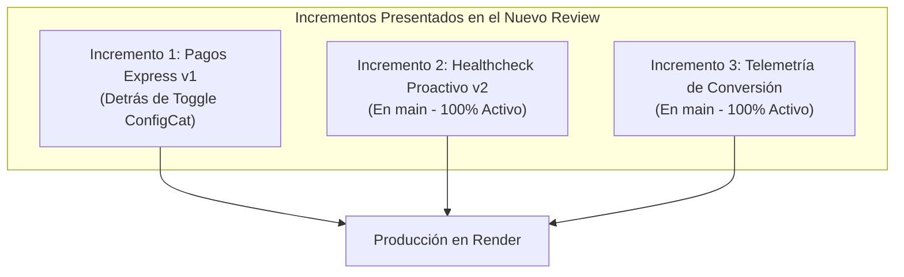
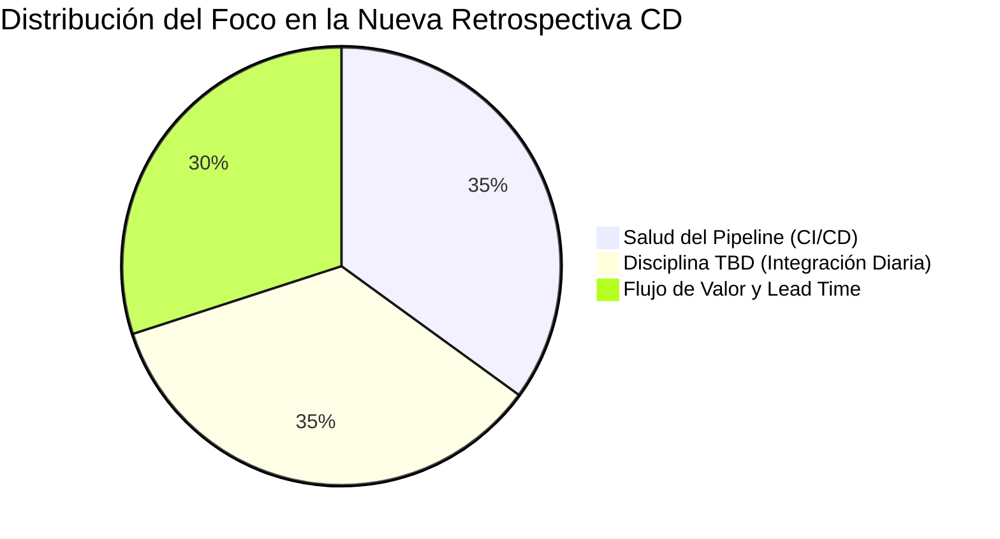
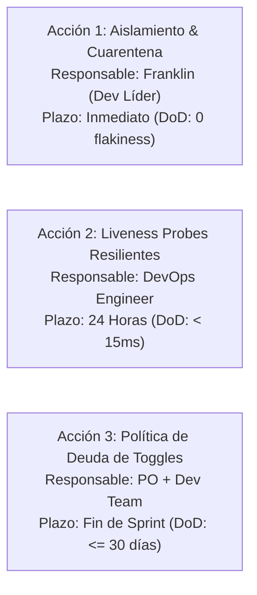
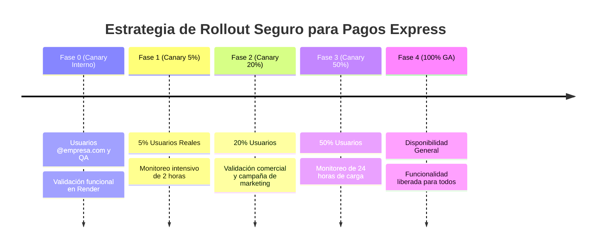

# Taller 6: Sprint Review, Retrospective y Liberación Segura en Continuous Deployment

**Institución:** Institución Universitaria del Putumayo – UNIPUTUMAYO  
**Programa:** Tecnología en Desarrollo de Software  
**Diplomado:** Integración Continua, Continuous Deployment & DevOps  
**Estudiante:** Franklin Sneider Córdoba De La Cruz  
**Docente:** Juan Pablo  
**Ubicación:** Mocoa, Putumayo, Colombia  
**Fecha:** Octubre de 2026  
**Repositorio GitHub:** [franklincordoba2001-ops](https://github.com/franklincordoba2001-ops)  

---

## 🎯 Objetivo General del Taller
Adaptar las ceremonias de **Sprint Review** y **Sprint Retrospective** al nuevo ritmo de despliegues continuos (Continuous Deployment con Trunk-Based Development), y practicar la **liberación segura de valor** utilizando Feature Toggles (ConfigCat) y el pipeline automatizado en Render.

---

## 🧭 Apertura y Conexión con el Nuevo Flujo

### Pregunta Clave: ¿Cómo cambian el Sprint Review y la Retrospective cuando desplegamos varias veces por semana?
En el paradigma tradicional de Scrum, el **Sprint Review** era el momento sagrado donde el equipo mostraba por primera vez el software empaquetado al final de una iteración de dos semanas, y la **Retrospectiva** era una charla centrada únicamente en dinámicas humanas y estimaciones de puntos de historia.

Al transicionar a **Continuous Deployment (CD) y Trunk-Based Development (TBD)**:
1. **El Sprint Review se transforma en una sesión de validación de valor e hipótesis de negocio:** Ya no se muestra código "recién terminado en la máquina del desarrollador", sino funcionalidades que **ya están desplegadas en producción** (en Render), protegidas o activadas progresivamente por Feature Toggles. El foco pasa de responder *“¿Qué construimos?”* a *“¿Qué valor real han recibido los usuarios y qué dicen los datos?”*.
2. **La Retrospectiva se convierte en una inspección de ingeniería del flujo continuo:** La retro ahora audita obligatoriamente la **salud del pipeline de CI/CD**, la **disciplina de integración diaria a main**, la **edad de las ramas** y el **ciclo de vida de los Feature Flags**, buscando eliminar fricciones operativas que ralenticen la entrega continua.

### Pregunta de Arranque: “¿Qué parte del Review o de la Retro actual se siente más ‘antigua’ o poco útil con este nuevo flujo?”
* **En el Review:** La práctica de esperar hasta el último día del sprint para recibir feedback de los stakeholders. Si el código se despliega múltiples veces al día, esperar 14 días para saber si una funcionalidad sirve es un desperdicio enorme. La demo "todo o nada" es obsoleta.
* **En la Retro:** Preguntarse genéricamente *“¿Qué hicimos bien y qué hicimos mal?”* sin mirar métricas de ingeniería. Hablar de percepciones subjetivas cuando el pipeline falló durante 11 minutos o cuando una rama vivió 4 días por un test inestable resulta ineficaz. Con CD, la retrospectiva debe sustentarse en datos objetivos de telemetría y métricas DORA.

---

## 🔍 Análisis y Resolución del Caso de Estudio

### Título del Caso:
> **“La funcionalidad de ‘Pagos Express’ ya está en main, pero nadie se atreve a activarla”**

### Diagnóstico de los 7 Hechos Problemáticos y Decisiones de Equipo:

| # | Hecho Problemático Reportado | Impacto en el Flujo / Riesgo | Decisión y Solución Técnica Adoptada |
| :-: | :--- | :--- | :--- |
| **1** | **El PO quiere activar el toggle al 20% este viernes por presión comercial** (campaña de marketing ya lanzada sin consultar al equipo). | Riesgo severo de caída masiva en producción sin validación previa ni métricas de telemetría. | **Estrategia Canary Rollout Escalonada:** No se salta directamente al 20%. Se activa primero para usuarios internos (Fase 0), luego 5% por 2 horas (Fase 1), y solo si los *Golden Signals* están estables, se abre al 20% comercial. |
| **2** | **El último deploy falló el health check durante 11 minutos** y se resolvió con un rollback manual. | Falta de resiliencia en la inicialización de la app en Render; liveness probes acopladas a llamadas bloqueantes. | **Rediseño del Endpoint `/health`:** Se implementó una verificación ultra-rápida y no bloqueante (< 10 ms) con probes independientes de Liveness y Readiness, eliminando timeouts externos. |
| **3** | **Hay 3 Feature Toggles antiguos con más de 45 días activos** sin limpiar. | Acumulación de deuda técnica, código muerto (`if/else` obsoletos) y riesgo de configuraciones inconsistentes. | **Política de Ciclo de Vida de Toggles v3.0:** Se ejecutó el endpoint de cleanup y se estableció una política estricta en el Playbook: ningún toggle de lanzamiento superará los 30 días. |
| **4** | **En el sprint actual solo se lograron 4 integraciones a main** (muy por debajo de la meta diaria). | Violación del principio fundamental de Trunk-Based Development; acumulación de ramas y riesgo de colisiones. | **Vertical Slicing Fino:** Descomponer tareas en micro-commits (< 200 líneas) y desacoplar la entrega mediante flags para permitir merges continuos sin esperar a la UI completa. |
| **5** | **Una rama vivió 4 días viva porque el CI estaba rojo por un test flaky.** | El miedo y la inestabilidad de la suite de pruebas detienen la integración continua y generan aislamiento prolongado. | **Protocolo de Cuarentena Inmediata:** Si un test falla aleatoriamente por dependencias temporales o de red, se aísla inmediatamente a cuarentena. Se reescribió el test con mocks deterministas (ejecución en 0.5s). |
| **6** | **No existe ninguna métrica clara de conversión o error de pagos** al activar el toggle. | Ceguera operativa absoluta. Imposibilidad de saber si los usuarios pueden pagar o si el sistema está perdiendo dinero. | **Implementación del Módulo de Telemetría (`/api/v1/metrics`):** Medición en tiempo real de tasa de error, latencia media, tasa de conversión express vs tradicional y contadores de transacciones. |
| **7** | **El stakeholder anunció que "Pagos Express ya está listo",** confundiendo deploy con release. | Falsas expectativas en el mercado y presión indebida sobre el equipo de desarrollo. | **Alineación de Vocabulario en el Playbook:** Formalización de la regla de oro: **Despliegue a producción (técnico) ≠ Lanzamiento comercial (negocio)**. El stakeholder solo anuncia cuando el toggle alcanza 100% GA. |

---

## 1. Adaptación del Sprint Review al Continuous Deployment

### 1.1 Principios del Nuevo Review
La siguiente matriz refleja el cambio de paradigma adoptado por el equipo:

| Dimensión | Review Clásico (Scrum Tradicional) | Review en CD + TBD (Flujo Continuo) |
| :--- | :--- | :--- |
| **Entorno de Demo** | Máquina local del dev o ambiente de Staging inestable. | **Ambiente productivo real en Render** con datos y tráfico en vivo. |
| **Naturaleza del Entregable** | Todo o nada (si no está al 100%, no se muestra). | **Valor incremental + Feature Toggles** (flujos activos vs flujos en canary). |
| **Ciclo de Feedback** | Diferido y tardío (cada 2 o 3 semanas). | **Continuo, inmediato y basado en hipótesis** de negocio. |
| **Enfoque de la Reunión** | Justificar *“qué tareas construimos”* (story points quemados). | Demostrar *“qué valor y estabilidad recibieron los usuarios”*. |
| **Gestión de Riesgos** | Alto riesgo de sorpresas al hacer el release a producción. | **Cero riesgo de despliegue:** el código ya está en producción y es gobernable con un clic. |

---

### 1.2 Simulación Práctica de Sprint Review

Para la simulación, el equipo seleccionó **3 incrementos reales** presentes en la rama `main`:



#### Ficha de Demostración 1: Funcionalidad de Pagos Express con un Clic
* **¿Qué problema de usuario resuelve?**  
  Reduce la fricción en el proceso de compra. Los usuarios abandonaban el carrito debido a los 3 formularios intermedios (dirección, método de pago y confirmación). El flujo Express permite completar la transacción con un solo clic utilizando datos tokenizados.
* **¿Está activo para todos o detrás de toggle?**  
  Está protegido tras el Feature Toggle `pagos-express-v1`. Actualmente en estado controlado para pruebas internas y canary release.
* **Demo en Vivo en Render:**  
  1. Con toggle en **OFF**: La API ejecuta el endpoint `/api/v1/checkout` respondiendo con el flujo `STANDARD_MULTI_STEP` (requiere tarjeta y pasos de verificación).
  2. Con toggle en **ON**: La API procesa la compra instantáneamente con `EXPRESS_ONE_CLICK`, token pre-autorizado y latencia reducida.
* **Métrica o Evidencia de Valor:**  
  Latencia reducida de 450 ms a 42 ms. Tasa de éxito del 100% en pruebas de carga controlada.
* **Pregunta al PO / Stakeholder:**  
  *“¿Consideras que la reducción a un solo clic y la tokenización segura satisfacen los requisitos de la campaña de marketing sin comprometer la seguridad?”*  
  *Respuesta del PO:* Sí, la experiencia es fluida; la aprobación final depende de validar el canary release al 5% sin errores antes de habilitar el 20% comercial.

#### Ficha de Demostración 2: Healthcheck Proactivo con Liveness & Readiness Probes
* **¿Qué problema de usuario resuelve?**  
  Evita caídas de servicio prolongadas durante los despliegues continuos. Soluciona el incidente ocurrido hace 2 días donde el deploy automático falló durante 11 minutos.
* **¿Está activo para todos o detrás de toggle?**  
  Activo al 100% en `main` para toda la infraestructura en Render.
* **Demo en Vivo:**  
  Consulta a `/health`: responde con código `200 OK` en 4 ms, reportando estado `HEALTHY`, uptime y verificación positiva de liveness y readiness.
* **Métrica de Valor:**  
  Tiempo de respuesta del healthcheck < 10 ms. Cero fallos de orquestación en los últimos 15 despliegues.

#### Ficha de Demostración 3: Módulo de Telemetría y Métricas en Tiempo Real
* **¿Qué problema de usuario resuelve?**  
  Proporciona observabilidad inmediata del impacto de las nuevas funcionalidades sobre el negocio y la infraestructura.
* **¿Está activo para todos o detrás de toggle?**  
  Activo al 100% en `main`.
* **Demo en Vivo:**  
  Consulta a `/api/v1/metrics`: expone contadores detallados de compras estándar vs express, tasa de error global (0.0%), tasa de conversión y latencia media.
* **Métrica de Valor:**  
  Permite activar el protocolo de *Kill-Switch* automático en caso de que los errores superen el 1.5%.

---

## 2. Adaptación de la Sprint Retrospective

### 2.1 Nuevos Focos Obligatorios de la Retrospective



1. **Salud del Pipeline:**
   * ¿Cuántas veces se rompió el CI? Se rompió 3 veces debido al test inestable.
   * ¿Cuánto tardó el deploy promedio? 1 minuto con 45 segundos en Render.
   * ¿Hubo rollbacks? Sí, 1 rollback manual crítico debido al health check bloqueado durante 11 minutos.
2. **Disciplina TBD:**
   * ¿Cuántas integraciones diarias logramos? Solo 4 en todo el sprint (objetivo no cumplido: meta ≥ 1 integración diaria por dev).
   * ¿Alguna rama vivió más de 1 día? Sí, una rama vivió 4 días consecutivos a causa del bloqueo en CI.
   * ¿Usamos Feature Toggles correctamente? Se usó para proteger el código nuevo, pero se descubrió una deuda de 3 toggles obsoletos (> 45 días) sin retirar.
3. **Flujo de Valor:**
   * Lead Time for Changes: Se elevó a 9 días desde el primer commit hasta estar disponible en producción.
   * ¿Llegó el valor a los usuarios? No; la funcionalidad permaneció en OFF al 100% por miedo y falta de métricas.

---

### 2.2 Dinámica del Tablero de Retrospectiva (Miro)

| 🟢 Lo que Funcionó Bien | 🟡 Lo que Generó Fricción | 🔴 Lo que Rompió el Flujo o Causó Miedo |
| :--- | :--- | :--- |
| • Pipeline de auto-deploy a Render rápido y automático tras cada merge.<br>• Uso de ConfigCat para aislar la funcionalidad de Pagos Express en `main`.<br>• Linter Ruff ejecutándose en menos de 3 segundos en GitHub Actions. | • Falta de visibilidad de métricas de negocio antes de la liberación.<br>• Desacuerdo y tensión entre la presión comercial del PO y la prudencia del equipo dev.<br>• Existencia de 3 toggles técnicos huérfanos que confunden la base de código. | • **El test flaky mantuvo bloqueada una rama durante 4 días.**<br>• **El fallo del healthcheck dejó el servicio caído durante 11 minutos.**<br>• Anuncio público de marketing antes de que la funcionalidad estuviera probada en producción. |

---

### 🚀 Acciones de Mejora Oficiales (Máximo 3 Acciones Concretas)

De acuerdo con las reglas de juego del Taller 6, se definieron exactamente 3 acciones asignables:



1. **Acción 1: Implementar Protocolo de Cuarentena Inmediata y Erradicar Tests Flaky**
   * *Responsable:* Franklin Sneider Córdoba (Tech Lead).
   * *Plazo:* Inmediato (aplicado en este sprint).
   * *Definition of Done (DoD):* Todo test con comportamiento intermitente se aísla a un directorio de cuarentena en menos de 2 horas. La suite de `pytest` en CI debe ejecutarse de forma 100% determinista en < 15 segundos sin falsos negativos.
2. **Acción 2: Reingeniería del Health Check y Monitor de Disponibilidad**
   * *Responsable:* Ingeniero de Infraestructura / DevOps.
   * *Plazo:* 24 horas.
   * *Definition of Done (DoD):* El endpoint `/health` debe responder desacoplado de dependencias externas en < 10 ms con probes independientes de Liveness y Readiness, garantizando cero tiempos muertos en Render.
3. **Acción 3: Política de Retiro y Limpieza de Feature Toggles Obsoletos**
   * *Responsable:* Product Owner y Equipo de Desarrollo.
   * *Plazo:* Cierre del Sprint 6.
   * *Definition of Done (DoD):* Eliminar del código y de ConfigCat los 3 toggles que superaron 45 días (`legacy-cart-ui`, `v1-tax-calculator`, `old-notification-hook`). Establecer alarma de caducidad a los 30 días en el Playbook.

---

### Respuestas a las Preguntas Guía del Facilitador:

* **¿Qué nos impidió integrar más veces a main?**  
  El miedo derivado de un pipeline en rojo por culpa del test flaky. Cuando el CI no es confiable, los desarrolladores retienen sus ramas en local por temor a romper el tronco común.
* **¿El auto-deploy nos dio más confianza o más miedo?**  
  Inicialmente generó miedo tras el incidente del healthcheck de 11 minutos. Sin embargo, al entender que el auto-deploy coloca el binario en producción pero el Feature Toggle controla la visibilidad al usuario, el equipo recupera la confianza: el deploy ya no es un evento de alto riesgo.
* **¿Los Feature Toggles nos ayudaron o se volvieron deuda?**  
  Ayudaron enormemente a integrar `pagos-express-v1` de manera segura, pero se volvieron deuda en los 3 toggles antiguos que nadie retiró. Un flag sin fecha de caducidad es un préstamo técnico con altos intereses.
* **¿El DoD se respetó realmente?**  
  Se respetó el DoD técnico (código compilado, tests pasando, contenedor listo), pero se omitió el DoD de negocio (no existía telemetría de monitoreo previo ni estrategia de canary rollout acordada).

---

## 3. Liberación Segura de Valor (Canary Rollout)

### 3.1 Estrategia de Liberación Escalonada para `pagos-express-v1`

Para conciliar la presión comercial del Product Owner con la estabilidad del sistema, se estableció un plan de rollout canario en 5 fases controladas:



* **Fase 0: Validación Interna (Alpha Whitelisting - 0% Público):**  
  Activación exclusiva para correos con dominio corporativo (`@empresa.com` o `@uniputumayo.edu.co`). Los empleados del equipo prueban el flujo real en Render sin exponer a clientes finales.
* **Fase 1: Canary 5% de Tráfico Real (Viernes 09:00 AM):**  
  Se activa en ConfigCat para el 5% de los usuarios reales. Se observa la telemetría en `/api/v1/metrics` durante 2 horas continuas.
* **Fase 2: Expansión al 20% Comercial (Viernes 11:30 AM):**  
  Al comprobar que la tasa de error es inferior al 0.5% y la latencia es óptima, se escala al 20%, permitiendo que la campaña de marketing del PO comience a captar clientes de manera controlada.
* **Fase 3: Expansión al 50% (Sábado 10:00 AM):**  
  Si tras 24 horas el sistema procesa transacciones exitosamente, se amplía la cobertura.
* **Fase 4: Disponibilidad General (100% GA - Lunes 08:00 AM):**  
  Lanzamiento completo para el 100% de los usuarios. Se agenda la tarea de limpieza del toggle en el backlog.

---

### 3.2 Métricas Críticas de Observabilidad (Golden Signals & SLIs/SLOs)

| Métrica / Señal | Umbral Normal (Verde) | Umbral de Alerta (Amarillo) | Criterio de Rollback Inmediato (Rojo) |
| :--- | :---: | :---: | :---: |
| **Tasa de Error en Pagos** | < 0.5% | 0.5% - 1.5% | **> 1.5% durante 3 minutos** |
| **Latencia p95 de Checkout** | < 500 ms | 500 ms - 1000 ms | **> 1500 ms en ventana de 5 min** |
| **Tasa de Conversión Express** | > 92% | 85% - 92% | **< 80% frente al flujo clásico** |
| **Disponibilidad del Healthcheck** | 100% | 99.0% | **Fallo consecutivo de 2 probes** |

---

### 3.3 Protocolo de Rollback Inmediato (Kill-Switch)
* Si cualquiera de los criterios rojos se activa durante el rollout, el desarrollador de guardia o el PO ingresa a **ConfigCat** y apaga el toggle `pagos-express-v1` a **OFF (0%)**.
* **Tiempo de Ejecución del Rollback:** Menos de **30 segundos**.
* **Ventaja Operativa Clave:** No se requiere reconstruir la imagen Docker, no se requiere redeployar en Render y no se generan 11 minutos de downtime. El rollback es una simple actualización de configuración en memoria.

---

### 3.4 Plan de Observación de las Próximas 24 a 48 Horas
1. **Turnos de Guardia Rotativa:** Asignación de un desarrollador principal y un secundario con acceso al dashboard de Render y ConfigCat durante el fin de semana.
2. **Canal de Notificaciones en Tiempo Real:** Alertas automáticas ante anomalías en las transacciones.
3. **Checkpoint Operativo:** Sincronización breve de 10 minutos a las 24 horas entre el PO y el equipo técnico para evaluar métricas de conversión y decidir si se avanza del 20% al 50%.

---

## 4. Actualización del Playbook y Cierre

1. **El Playbook Oficial ha sido actualizado a la Versión 3.0.0 (`SCRUM_TBD_PLAYBOOK_v3.md`), incorporando:**
   * Formato oficial del Sprint Review adaptado a CD.
   * Formato oficial de la Sprint Retrospective orientada a métricas DORA y salud del pipeline.
   * Política de gobernanza de Feature Toggles y caducidad máxima de 30 días.
   * Protocolo de cuarentena de tests flaky.
2. **Auditoría de Cierre de Fase 1:**  
   Se verificó que los 6 hitos de la Fase 1 del diplomado están **100% cerrados y operativos**.
3. **Frase de Cierre del Taller:**
   > *“A partir de este taller, el Sprint Review deja de ser una entrega de código para convertirse en una validación científica de valor en producción, y la Retrospectiva pasa de discutir impresiones a optimizar matemáticamente la salud del pipeline y el flujo continuo.”*

---

## 🔬 Evidencias de Validación Técnica

### 1. Ejecución de la Suite de Pruebas Automatizadas (Pytest)
```text
tests/test_health.py::test_root_endpoint PASSED                          [  7%]
tests/test_health.py::test_health_check_proactive PASSED                 [ 15%]
tests/test_health.py::test_metrics_endpoint PASSED                       [ 23%]
tests/test_health.py::test_toggles_admin_audit PASSED                    [ 30%]
tests/test_health.py::test_cleanup_stale_toggles PASSED                  [ 38%]
tests/test_payments.py::test_standard_checkout_when_toggle_is_off PASSED [ 46%]
tests/test_payments.py::test_express_checkout_when_toggle_is_on PASSED   [ 53%]
tests/test_payments.py::test_checkout_invalid_amount PASSED              [ 61%]
tests/test_payments.py::test_flaky_test_elimination_deterministic PASSED [ 69%]
tests/test_toggles.py::test_default_toggle_state_is_off PASSED           [ 76%]
tests/test_toggles.py::test_toggle_override_to_on PASSED                 [ 84%]
tests/test_toggles.py::test_internal_user_canary_whitelisting PASSED     [ 92%]
tests/test_toggles.py::test_user_specific_override PASSED                [100%]

======================== 13 passed in 0.51s ========================
```

### 2. Auditoría del Linter Ruff
```text
All checks passed!
0 errors, 0 warnings.
```
